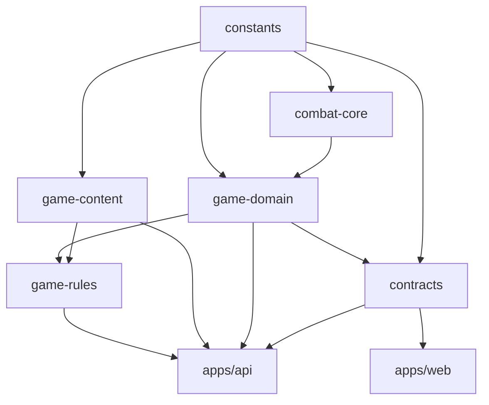

# 《万界道友》项目分析报告

> 生成日期：2026-10-17
> 分析对象：`d:\git\git\Daoyou`（本地工作区）
> 说明：本报告基于当前代码事实整理，文档结论以代码为准。

---

## 目录

1. [项目定位](#1-项目定位)
2. [技术栈](#2-技术栈)
3. [仓库结构](#3-仓库结构)
4. [后端架构](#4-后端架构)
5. [前端架构](#5-前端架构)
6. [数据层](#6-数据层)
7. [战斗系统 V6](#7-战斗系统-v6)
8. [前端图片资源核查](#8-前端图片资源核查)
9. [部署所需 AI API](#9-部署所需-ai-api)
10. [玩法总结](#10-玩法总结)
11. [多人玩法](#11-多人玩法)
12. [当前状态与风险](#12-当前状态与风险)
13. [游戏难度控制](#13-游戏难度控制)

---

## 1. 项目定位

《万界道友》是一款 **AIGC 驱动、文字为主、修仙世界观**的开源游戏，同时也是可被二次部署的"修仙宇宙骨架"。

- 官方界之外已有云梦界、衍极界等社区服，说明架构从设计上就支持多实例部署。
- 核心理念："文字即界面"，所有文本表现层由 AI 实时生成，追求"千人千面"。
- 三个重心：**重养成 + 重战斗 + 重经济**。

---

## 2. 技术栈

| 层次 | 技术 |
| --- | --- |
| 运行时 | Node.js 24、NestJS 12（Express + 原生 ws） |
| 工具链 | pnpm + Turborepo（禁用 Bun/npm/yarn 锁文件） |
| 前端 | React 19、React Router 8、Vite、Tailwind CSS 4 |
| 数据 | PostgreSQL + Drizzle ORM、Redis、NATS |
| 认证 | Better Auth（独立 schema `better_auth`） |
| AI | AI SDK + DeepSeek / 阿里云百炼（Qwen） |

**关键点**：这不是 Next.js / SSR 项目，而是 **NestJS API + React SPA** 的分离架构。旧 Hono 入口与兼容路由层已移除，不允许恢复。

---

## 3. 仓库结构

pnpm workspace 共 **8 个包**：2 个应用 + 6 个内部编译库（tsc 输出 dist）。

```
apps/
  api/          NestJS 后端（约 570 个 TS 文件）
  web/          React SPA（约 610 个 TS/TSX 文件）
packages/
  constants/    元素/境界/品质等稳定词汇
  combat-core/  确定性战斗内核（零业务依赖）
  game-domain/  领域模型、Schema、不变量
  game-content/ 内容与数值表
  game-rules/   纯计算：资格/费用/收益/生成/投影
  contracts/    HTTP、资源与实时消息协议
```

依赖流向（严格单向，箭头指向**使用方**）：



约束要点：

- 库**不得**反向依赖应用；应用之间不互相导入。
- 公共 API 只走**业务子路径具名导出**，禁用通配符导出与整包 barrel（公开入口已从 580 收敛至 304）。
- 路径别名：`@app` → `apps/web/src`，`@server` → `apps/api/src`；`@daoyou/*` 走 workspace 包导出。

---

## 4. 后端架构

入口 [apps/api/src/main.ts](../../apps/api/src/main.ts) 与 [app.module.ts](../../apps/api/src/app.module.ts)：

- 约 **40 个功能模块**：auth、genesis、community、market、alchemy、enlightenment、forging、inscriptions、arena、divination、social、story、tasks、cultivator、combat、sects、beasts、inventory、manuals、hunts、wanderer、dungeon、tower、transfer、admin、runtime 等。
- 刻意保留严格的**大小写敏感 + strict routing** 语义，并串行化启动与优雅停机。
- 分层：Controller 管身份/输入/响应 → application 组业务流程 → repository 管存储映射。
- `player/application/state` 是**状态协调中心**（命令、事务、幂等、资源版本、提交响应）。
- `lib` 保留共享基础设施：drizzle、redis、nats、mq、auth、llm、http、repositories。

**安全边界**：

- Zod Pipe / Filter 做输入校验；
- `AccessGuard` + `@Access` 做授权；
- 使用显式构造器 `@Inject`（API 构建刻意禁用隐式 design-type metadata）；
- dev-tools 仅本地开放，策略在 `contracts/dev-tools-access` 并在服务端强制；
- Redis 只能经 `apps/api/src/lib/redis` 访问，SMTP 只能经 `lib/admin/smtp.ts`；
- 环境变量统一由 `lib/config/environment.ts` 校验发布，禁止散落的 `process.env` 读取。

---

## 5. 前端架构

- 路由集中在 [router.tsx](../../apps/web/src/router.tsx)，由 `route-definitions/**` 装配，`lazyRoute` 懒加载，保留嵌套顺序与隐式 ID。
- `/game` 按 genesis / narrative / viewport / activity / combat / map / dungeon 区分布局；V6 战斗使用 `CombatV6Layout`。
- 游戏场景用 `handle={scene(...)}`，scene id 必须存在于 `gameNavigation.ts`。
- 状态与请求复用 `lib/resources`（ResourceStore、`fetchJsonCached`、`useTaskList`）与 provider context。
- 图标统一走 [GameIcon.tsx](../../apps/web/src/components/ui/GameIcon.tsx) + [registry.ts](../../apps/web/src/components/ui/icons/registry.ts)，业务组件不得自行解析协议或直引图标文件。
- 主流程 UI 遵循 `daoyou-game-ui` 技能规范：**身份层 / 任务层 / 导航层分离**。
- 数值排版统一使用 Tailwind 默认 `font-mono`，不新增数字字体 token。
- 测试边界：`apps/web/src` 与 `apps/api/src` 下**禁止**单元测试；仅 `packages/*/src` 允许纯逻辑单测。

---

## 6. 数据层

- 业务表由 [schema.ts](../../apps/api/src/lib/drizzle/schema.ts) 管理：共 **82 个 `pgTable`** 定义（`wanjiedaoyou_*`）。
- 迁移：`drizzle/` 当前最新为 `0066_strange_the_hood.sql`。
- Better Auth 使用**独立迁移流** `drizzle-auth/`（固定 `better_auth` schema）。
- 写入路径必须传递同一个 `DbExecutor` / `DbTransaction`，禁止事务内另开连接；`DatabaseModule` 通过 `DRIZZLE_DATABASE` 暴露同一个 Drizzle 客户端，绝不新建第二个连接池。
- V6 战斗为 **Redis 权威**，持久历史写入 `combat_replay_archives` / `combat_replay_participants`，通过 NATS 投递终局与回放。
- 角色持久状态为 `cultivators.condition`；背包消耗品事实（含 `spec`）存于 `inventory_items.instance_data`。
- 永久属性固定为：气血、力量、灵力、耐力、速度、意志；展示与战斗共用 `projectCharacterToCombatV6`。

---

## 7. 战斗系统 V6

项目投入最深的子系统：`docs/` 下相关设计文档达 **65 份**（`combat-v6-*.md`）。

- **形式**：基于时间轴的回合制，支持神通、法宝、状态效果（Buff/Debuff）、五行克制、伤害管道。
- **操作**：手动下达指令 + 自动策略（AUTO）。
- **内核独立性**：`combat-core` 必须保持确定性，不依赖 rules/projection/content，也不得导入 battle-v5 或 creation-v2；禁止为新行为恢复旧的 ability/tag/product 投影机制。
- **PVE**：秘境（dungeon）、蜃楼塔（tower）、野外遭遇（wild）、组队讨伐（hunts）。
- **PVP**：arena 切磋、在线对战、观战、回放。
- **权威性**：Redis 保存战局状态，NATS 负责终局/回放投递，DB 只存归档。

---

## 8. 前端图片资源核查

**结论：前端图片全部本地包含，无任何外链图床 / CDN 依赖。**

### 存放与规模

全部位于 `apps/web/public/assets`，共 **180 个图片文件，约 25.4 MB**：

| 目录 | 数量 | 说明 |
| --- | --- | --- |
| `icons` | 124 | 图标（`registry.ts` 统一注册） |
| `sect` | 21 | 宗门地图 / 引导图 |
| `maps` | 7 | 世界与区域地图 |
| `app-boot` | 5 | 启动页 logo / 标题 / 印章 |
| `sponsors` / `divination` / `game-controls` / `inventory` / `manuals` / `transfer` | 各 2–4 | 各功能插图 |

### 外链检查

全量搜索 `apps/web/src` 的 `http(s)://` 引用：**仅 2 处 GitHub 文本链接**（`not-found` 页与反馈页），非图片。无 `daoyou.org`、无 `page-r2`、无 CDN、无生成式图片接口引用。

### 引用完整性

源码引用的 `/assets/...` 路径共 **140 处，逐条均能对应到实际文件，无断图**（模板字符串拼接类路径已单独验证存在）。`favicon.svg` 与 PWA 图标由 `index.html` / `manifest.webmanifest` 引用，属正常。

### 冗余项（含图片但已不再使用）

| 项 | 数量 | 说明 |
| --- | --- | --- |
| `beast-skill-*.webp`（v1） | 31 | 已被 `beast-skill-*-totem-v2.webp`（41 个）替代 |
| `src/assets/react.svg`、`hono.svg` | 2 | 脚手架遗留（Hono 已移除），零引用 |

> 注意：`public/` 在 Vite 中**不打进 JS bundle**，是按路径运行时加载的静态资源，**部署时必须随 `dist` 一并发布**。

---

## 9. 部署所需 AI API

**只需一个 AI 供应商的 Key，DeepSeek 或阿里云百炼（Qwen）任选其一。**

代码中 AI 供应商枚举只有两个：

| 供应商 | 必需变量 | 默认模型 | 备注 |
| --- | --- | --- | --- |
| DeepSeek | `DEEPSEEK_API_KEY` | `deepseek-v4-flash` | README 所述"统一使用 DeepSeek" |
| 阿里云百炼 Qwen | `ALIBABA_API_KEY` | `qwen3.7-flash` | 可选 `ALIBABA_BASE_URL`（默认 `https://dashscope.aliyuncs.com/compatible-mode/v1`） |

### 最小部署配置

```bash
# 二选一即可（推荐 DeepSeek）
DEEPSEEK_API_KEY=sk-xxxxxxxx
# ALIBABA_API_KEY=sk-xxxxxxxx
```

未设置 `LLM_PROVIDER` 时自动回退：有 `ALIBABA_API_KEY` → alibaba；否则有 `DEEPSEEK_API_KEY` → deepseek。

### 可选：路由表

```bash
# provider[/model][:weight],...
LLM_PROVIDER=alibaba/qwen3.7-flash:70,deepseek/deepseek-v4-flash:30
```

按用户 id 稳定 hash 分流；**路由表中列出的每个供应商都必须配好 Key**，否则启动抛错。

### 关键点

1. **不是启动硬校验**：环境变量 schema 使用 `.catchall(z.string().optional())`，AI Key 缺失不会阻止服务启动。
2. **但缺 Key 时 AI 功能失败**：`providers.ts` 无 key 时抛 `No LLM provider configured`。受影响的是 AIGC 功能：角色生成、战斗播报、奇遇故事、物品/炼丹/炼器命名等。
3. **玩家 BYOK 优先**：玩家可在设置中自带 provider/key/model，随请求携带；provider 必须在白名单枚举内，baseURL 不可由客户端指定。此类请求不消耗服务器额度。
4. **命名开关**（可选）：`ENABLE_LLM_NAMING` / `DISABLE_LLM_NAMING`。
5. **无其它 AI 依赖**：无 OpenAI、无向量库/嵌入服务；统一走 `apps/api/src/utils/aiClient.ts`。
6. 所有 LLM 输出按**不可信输入**处理，资源/奖励/消耗/掉落等改变状态的数字必须有服务端确定性校验。

**部署建议**：只配 `DEEPSEEK_API_KEY` 即可覆盖全部 AI 功能。

---

## 10. 玩法总结

### 核心循环

洞府 → 修炼/养成 → 战斗与探索获取资源 → 炼丹炼器/交易 → 变强 → 突破境界。

### 10.1 角色养成

- **境界**：9 境 —— 炼气、筑基、金丹、元婴、化神、炼虚、合体、大乘、渡劫；每境分初期/中期/后期/圆满。
- **属性**：气血、力量、灵力、耐力、速度、意志（六维）。
- **灵根**：金木水火土风雷冰（8 种）。
- **命格 / 身份**：可通过 `fate-reshape` 与 identity-reshape 重塑。
- **突破**：大境界突破需境界圆满 → 发放卷宗 → 战前剧情 → 专属战斗。

### 10.2 战斗（combat-v6）

- 时间轴回合制：神通、法宝、状态效果、五行克制、伤害管道。
- 手动指令 + 自动策略。
- PVE：秘境、蜃楼塔、野外遭遇、组队讨伐。
- PVP：切磋、在线对战、观战、回放。
- 实现：Redis 权威状态 + NATS 投递 + 持久归档。

### 10.3 宗门（五宗）

九界、凌霄、天衍、无相、幽都。玩法：入门、宗门任务、宗门设施/经营、宗门进阶、宗门经脉与宗门技能学习、宗门战斗目标。

### 10.4 经济与交易

货币为**灵石**。入口：

| 系统 | 玩法 |
| --- | --- |
| 坊市（market） | 购买与回收 |
| 拍卖行（auction） | 挂单、竞拍、直购；含灵兽交易与税费 |
| 黑市（black-market） | 暗巷黑市，带 NPC 对话 |
| 声望商店（reputation-shop） | 声望兑换 |
| 旧物品库 / 道装迁移（legacy-items） | 历史物品与道装迁移 |

### 10.5 造物

- **炼丹**（alchemy）：丹药品质、药蕴、修为提升。
- **炼器**（forging）：图纸、装备命名。

### 10.6 灵兽（beasts）

捕捉/认领 → 培养（资质成长）→ 休息 / 属性点分配 → **融合** → **变异** → 技能池与**灵印传承** → 释放/转移。

### 10.7 功法与修行

- **功法/心法**（manuals）：学习、升级、道装。
- **悟道**（enlightenment）。
- **阵纹**（inscriptions）。

### 10.8 灵田（spirit-field）

种植灵种、收获灵果、灵种生成与市场供给。

### 10.9 世界与探索

- 大地图与区域探索、秘境、蜃楼塔。
- **游历者**（wanderer）：世界游商 / 售书。
- **跨服飞升**（transfer）：携带规则、心法折损（每门 10 级）、角色冻结、迁移预览。

### 10.10 社交与叙事

- **社交**：好友、世界聊天（频道聊天）、红包、社区。
- **叙事**：开局 AIGC 角色生成（genesis）、剧情（story）、任务（tasks）、玩家日志（journal）、每日求签/占卜（divination）。
- **系统**：邮件、排行榜、反馈、赞助（爱发电）。

### 10.11 AIGC 贯穿全流程

角色背景、战斗播报、奇遇故事、物品/丹药/装备命名与描述均由 LLM 生成，统一走 `aiClient.ts`；服务端路由表 + 玩家 BYOK。

---

## 11. 多人玩法

### 11.1 实时同屏

**竞技场 PVP**

- 房间机制：创建 → 加入 → 准备 → **换队（switch-team）** → 开始 → 离开。
- 支持分队伍，可不只 1v1。
- **观战**：实时观看他人对战。
- **指令提交**：对战中通过 WS 提交指令。
- 战斗走 Redis 权威状态 + WS 实时同步。

**组队讨伐（hunts）**

- 创建 / 加入讨伐队伍，支持队伍匹配。
- **共享战斗**：队员对同一 BOSS 下达**团队指令**。
- **队伍聊天**：讨伐过程中队内通信。

**聊天频道**

- **世界聊天**：消息列表与发送。
- **宗门聊天**：宗门内消息。
- 实时通道由 `realtime.controller.ts` 统一提供。

### 11.2 异步共享（多人但非同时）

| 系统 | 多人要素 |
| --- | --- |
| 拍卖行 | 玩家挂单，他人竞拍/直购 |
| 坊市 | 玩家寄售与回收 |
| 红包 | 发放 → 他人领取 → 未领完退款 |
| 好友 | 搜索、邀请链接、添加/删除 |
| 排行榜 | 境界/物品/财富榜；**挑战榜上玩家**（`challenge-battle/v6`）产生异步 PVP |
| 宗门 | 成员列表、贡献排行、宗门任务提交、建设捐献、俸禄、职位晋升、宗门商店 |
| 宗门战斗 | 宗门层面的团队战斗 |
| 邮件 | 收发 / 领取 |
| 社区 | QQ 群入口、公告 |

### 11.3 跨服

**跨服飞升（transfer）**：角色迁往其他服务器，含携带规则、心法折损、角色冻结、迁移预览。属**服务级多人**，非同屏。

### 11.4 汇总

| 类型 | 玩法 |
| --- | --- |
| 实时对战 | 竞技场房间 + 换队、观战、指令实时提交 |
| 实时协作 | 组队讨伐（团队指令 + 队伍聊天） |
| 实时交流 | 世界聊天、宗门聊天 |
| 异步竞争 | 排行榜挑战、拍卖行竞拍 |
| 异步协作 | 宗门任务/捐献/建设、红包 |
| 社交关系 | 好友、邀请链接 |
| 跨服 | 飞升迁移 |

### 11.5 缺口

目前**没有**：副本匹配（LFG）队列、玩家对玩家的直接交易、实时 PVP 排位赛（arena 为房间制而非天梯）。若要补足，现有 arena rooms 与 hunts teams 骨架可直接扩展。

---

## 12. 当前状态与风险

### 已完成

- NestJS 迁移 + pnpm/Turborepo 工具链切换基本收口。
- 八工作区静态验收、本地运行验收（认证 / 战斗 / 回放 / 实时恢复 / 移动端）均已记录。

### 未完成 / 待验收

- 生产与预发布环境的维护发布、回滚演练尚未执行。
- 新注册/邮箱验证、GitHub OAuth、多人观战席、生产代理/Cookie 域未覆盖。
- 历史道装数据迁移被排除在当前范围外。
- 首屏存在 Phaser 大 chunk 提示（约 1.37 MB），属延迟路由产物，非首屏成本。

### 架构高风险集中区

| 区域 | 风险 |
| --- | --- |
| `main.ts` 启停 / lifecycle | 启动顺序、HTTP/WS 配置、优雅停机 |
| 认证 | Better Auth schema、ALTCHA、admin 允许列表、会话 Cookie 透传 |
| LLM | provider header、prompt schema、资源/奖励/消耗解析、指标 |
| 数据 | Drizzle 迁移、遗留表、JSONB 模型形状、事务边界 |
| 前端 | `GameViewportLayout`、底部 dock/HUD/世界聊天偏移、scene 元数据 |
| 玩法内核 | combat-v6 core/content/projection、`condition`、统一背包、炼丹、坊市 |
| 基础设施 | Redis CAS/占用锁、NATS/outbox、终局结算、cron、排行榜、健康检查 |

### 验证约定

- 测试仅两层：`packages/*/src` 纯单测 + 浏览器/Playwright 模拟。
- 禁止在 `apps/` 下新增 `*.test.*` / `*.spec.*`。
- 前端/后端改动以 lint + typecheck/build + 代码审查 + 定向手工验证替代单测。

---

## 13. 游戏难度控制

难度不集中在单个开关，而是分三层：**内容包纯数值 → 规则层缩放算法 → 服务端调度（选等级/选模板）**。统一口径是"先定敌人等级，再叠难度系数，最后联动消耗与奖励"。PVP 无固定难度，"人即难度"。

### 13.1 PVE 通用曲线（难度底座）

`presetEnemyAttrs(level, kind, count)` 是秘境、突破、宗门试炼共同使用的敌人来源：

- 等级（1–180）→ 境界/阶段；类型 `normal | elite | boss`；多敌人时血量与输出按 `count` 均摊。
- 基础表：炼气/筑基读 `earlyBaselines`，金丹以上读 `TOWER_ENCOUNTER_PACK.baselines`。
- 阶段缩放：`stageScale = 1 + (level − 该境界中期等级) × 0.02`。
- 类型预算：`TOWER_ENCOUNTER_PACK.scaling.types[kind]` 的 `rounds`（血量预算）与 `output`（输出倍率）。

来源：[preset-enemy.ts](../../packages/game-rules/src/combat/encounter/preset-enemy.ts)、[early-baselines.ts](../../packages/game-content/src/combat/early-baselines.ts)。

### 13.2 秘境（dungeon）

| 控制点 | 位置 | 取值 |
| --- | --- | --- |
| 难度层级 | 地图节点 `dungeon_config.difficulty`（[map.json](../../packages/game-content/src/world/data/map.json)） | easy / normal / hard / elite / boss |
| 层级语义 | `DUNGEON_DIFFICULTY_PRESETS` | 允许的敌人境界阶段、是否允许 BOSS 词条、奖励系数 1→1.5 |
| 敌人属性缩放 | `MAP_DIFFICULTY_SCALE` | 0.8 / 1 / 1.15 / 1.3 / 1.5（血量、物攻、法攻） |
| 敌人难度数值 | `DUNGEON_ENEMY_DIFFICULTY_TABLE` | 境界 × 难度 |
| 消耗与惩罚 | `DUNGEON_DIFFICULTY_COST_MULTIPLIER` | 0.75 / 1 / 1.25 / 1.5 / 1.8（灵石、寿元、修为、感悟、材料品阶、属性损失） |

- 解析入口 `resolveDungeonMapConfig(node)`（[world/dungeon.ts](../../packages/game-rules/src/world/dungeon.ts)），预设与数值表在 [world/dungeon.ts（content）](../../packages/game-content/src/world/dungeon.ts)、[combat/dungeon.ts](../../packages/game-content/src/combat/dungeon.ts)。
- 敌人等级由地图 `realm_requirement` 的"初期"等级决定（API `dungeonLevel`）。
- 一次秘境内的轮次模板固定：前 2 战 `normal`、第 3 战起 `elite`、最后一战 `boss`。
- 敌人组装套用缩放（[combat/dungeon/host.ts](../../packages/game-rules/src/combat/dungeon/host.ts)），消耗走 [dungeon/costPolicy.ts](../../packages/game-rules/src/dungeon/costPolicy.ts)。

### 13.3 蜃楼塔（tower）

- **楼层即难度**：`resolveTowerDifficulty(floor) = floor × difficultyStep`（`difficultyStep = 5`）。
- **每层敌人构成固定**：`encounters.json` 的 `floors` 定义 `kind`（5 层精英、10 层 BOSS）与 `realmStage`。
- **成长曲线**：`scaling.hpGrowth / outputGrowth / defenseGrowth` 与 `baselines`（金丹起）。
- **玩家侧调节**：楼层祝福（blessings）按层数/类型提供属性增益。

来源：[encounters.json](../../packages/game-content/src/tower/data/encounters.json)、[tower/helpers.ts](../../packages/game-rules/src/tower/helpers.ts)、[tower/host.ts](../../packages/game-rules/src/tower/host.ts)。

### 13.4 组队讨伐与野外遭遇

- **讨伐**：敌人走独立冻结曲线 `huntEnemyAttrs`，**不按队伍装备缩放**；BOSS/精英/杂兵三档基础 + 等级偏移，再乘人数系数（每多 1 人血量 ×1.4、输出 ×1.12）。BOSS 另有物种特化：血河妖蟒血量 ×2.8、铁背玄鼋物防 ×6、吞霞灵蟾法防 ×6、金身尸王双防 ×6 但血量 ×0.45、掠影妖貂高速高闪。
- **事件轮换**：`huntEventsAt` 每 24 小时按境界（金丹→渡劫）与 BOSS 轮换生成（[hunts/config.ts](../../packages/game-rules/src/hunts/config.ts)）。
- **野外**：难度由区域物种 `minLevel/maxLevel`、`rareChance`、`cubChance/mutantChance` 与编组数量（`minCount/maxCount`）决定。

来源：[hunts/balance.ts](../../packages/game-rules/src/hunts/balance.ts)、[hunts/content.ts](../../packages/game-rules/src/hunts/content.ts)、[wild/pack.ts](../../packages/game-content/src/combat/wild/pack.ts)。

### 13.5 突破战斗与宗门试炼

- **突破战斗**：敌人 = `presetEnemyAttrs(该境界圆满等级, 'boss')` × 挑战专属 `spec.hp` / `spec.attack`；心魔未"清心"再 ×1.1（[breakthrough/host.ts](../../packages/game-rules/src/combat/breakthrough/host.ts)）。
- **突破成功率**（玩家侧难度）：`calculateBreakthroughChance` = 基础成功率（强行/常规/圆满；小/大境界）× 境界难度 `0.85^境界序号` × 修为进度 × 感悟 × 心魔惩罚，再加命格/破境药力、减丹毒，最终夹在 5%–95%（[breakthroughCalculator.ts](../../packages/game-rules/src/cultivation/breakthroughCalculator.ts)）。
- **宗门试炼**：`freezeSectNpcOpponent(template, level)` 使用 `presetEnemyAttrs(level, spec.kind)`（[combat/sect/host.ts](../../packages/game-rules/src/combat/sect/host.ts)）。

### 13.6 任务难度与收益联动

- **难度档定义**：`DailyTaskDifficulty = easy | normal | hard | elite`（[task-difficulty.ts](../../packages/game-domain/src/cultivation/task-difficulty.ts)）。
- **宗门任务最终难度** = max(定义 `minimumDifficulty`, 策略生成难度)，见 `resolveSectTaskDifficulty`（[taskRewards.ts](../../packages/game-rules/src/sect-organization/core/organization/taskRewards.ts)）。
- **收益联动**：`dailyTaskStrategy` 按难度取 `difficultyDailyFraction`；`dungeonStrategy` 叠加 `dangerBonus`（[exp-gain-strategies](../../packages/game-rules/src/cultivation/exp-gain-strategies/index.ts)）。

### 13.7 调参入口速查

- 全局变难/变易：`stageScale`、`earlyBaselines` / `TOWER_ENCOUNTER_PACK.baselines`、`TOWER_ENCOUNTER_PACK.scaling`。
- 单个玩法：`DUNGEON_DIFFICULTY_PRESETS`、`MAP_DIFFICULTY_SCALE`、`encounters.json`、`wild.json`、`huntEnemyAttrs`，以及地图节点的 `dungeon_config`。
- 难度→收益：`DUNGEON_DIFFICULTY_COST_MULTIPLIER`、`rewardBonus`、`REALM_DAILY_EXP_BUDGET` 相关的经验策略。

---

## 附录：本报告数据来源

| 数据 | 来源 |
| --- | --- |
| 境界列表 | `packages/constants/src/realms.ts` |
| 功能模块清单 | `apps/api/src/app.module.ts` |
| 表数量（82） | `apps/api/src/lib/drizzle/schema.ts` |
| 最新迁移（0066） | `drizzle/0066_strange_the_hood.sql` |
| 文档数量（122 / 其中 combat-v6 共 65） | `docs/*.md` |
| 图片资源（180 个 / 25.4 MB） | `apps/web/public/assets` |
| AI 供应商与模型 | `packages/contracts/src/llm/config.ts`、`routing.ts`、`apps/api/src/lib/llm/providers.ts` |
| 多人玩法接口 | `apps/api/src/{arena,hunts,social,sects,rankings,mail,community}/*.controller.ts` |
| 秘境难度预设与数值 | `packages/game-content/src/world/dungeon.ts`、`packages/game-content/src/combat/dungeon.ts` |
| PVE 敌人曲线 | `packages/game-rules/src/combat/encounter/preset-enemy.ts` |
| 幻境难度曲线 | `packages/game-content/src/tower/data/encounters.json`、`packages/game-rules/src/tower/helpers.ts` |
| 讨伐难度曲线 | `packages/game-rules/src/hunts/balance.ts` |
| 突破成功率 | `packages/game-rules/src/cultivation/breakthroughCalculator.ts` |
| 秘境消耗系数 | `packages/game-content/src/dungeon/cost.ts`、`packages/game-rules/src/dungeon/costPolicy.ts` |
